# PlacementPrep AI

An AI-powered placement-preparation platform: match your resume against a job description with an **explainable score**, ask questions answered **only from your own notes (RAG, with citations)**, practise **mock interviews** with rubric-based feedback, and get a **preparation plan** and **progress analytics** built from what you have actually done.

**MERN, JavaScript only** (React + Vite + Tailwind, Express, MongoDB/Mongoose). LLM and embeddings: **Google Gemini** through the official `@google/genai` SDK, behind an interchangeable provider adapter. Vector search: **MongoDB Atlas Vector Search**.

## What is and isn't verified (read this first)

| Area | Status |
|---|---|
| Server logic, validation, auth, ownership, consent, scoring, caching, quotas, error handling | **Tested**: 265 automated tests (real MongoDB-compatible database, real Express app) |
| Full UI flows in a real browser (all features, mobile layout, error states) | **Tested**: 128 browser checks across three suites in `e2e/` |
| Gemini provider code (request shape, errors, retries, timeouts, embeddings) | Tested by running the **real SDK** against a local server that speaks Gemini's wire format |
| **Live Gemini API behaviour** (real models, real answers, real quotas) | **Not tested**: the build environment could not reach Google. Run `cd server && npm run ai:check:full` with your key |
| **MongoDB Atlas Vector Search** | **Not tested on a real cluster.** The pipeline was checked against published working code and the driver's types. Retrieval is tested with an exact-cosine stand-in (`VECTOR_SEARCH_MODE=local`) |
| RAG answer quality | **Not measured.** `npm run rag:eval` exists to measure it with your provider. Do not quote any accuracy figure until you have run it, and the dataset (14 questions) is too small for accuracy claims anyway |
| Deployment (Render, Vercel, CI) | Configuration written, **never deployed or run** |

The test database was FerretDB (a MongoDB-compatible server), because MongoDB's downloads were unreachable. Run `npm test` against a real `mongod` or Atlas (`MONGODB_URI_TEST`) to confirm. Details of how Gemini facts were checked: [docs/AI_PROVIDER_NOTES.md](docs/AI_PROVIDER_NOTES.md).

## Features
- **Auth and dashboard**: register/login, httpOnly-cookie JWT with CSRF protection, per-user data, real-data dashboard.
- **Resume Analyzer**: PDF upload, job-description matching, weighted explainable score, evidence quotes verified in code, conditional (never fabricated) suggestions, prioritised checklist, interview questions, saved history.
- **Documents + Technical AI Assistant (RAG)**: upload notes (PDF), page-aware chunking, embeddings, Atlas Vector Search, grounded answers with clickable citations (file, page, passage), "not in your notes" instead of guessing, conversation history.
- **Mock Interviews**: category/role/difficulty/length, optional job description or resume-analysis personalisation, one question at a time, rubric-based evaluation (correctness, completeness, relevance, clarity), follow-ups, saved sessions to review.
- **Preparation Plan**: deterministic recommendations from saved interview and analysis results, AI-written study actions, completion tracking, reopening on new low scores.
- **Progress**: counts, match-score, interview and quiz trends, topic averages, topics needing revision, application counts, filters, plan progress, recent activity: all derived from saved records.
- **Applications tracker**: a Kanban board (Saved, Applied, Interview, Offer, Rejected) with deadlines, notes, safe job links, status history, and an optional link to a resume analysis. Plain CRUD, no AI.
- **Compare analyses**: a deterministic, skill-by-skill diff between two saved reports (for example before and after improving your resume). No AI call.
- **Quizzes from your notes**: multiple-choice questions written from random passages of your own documents, each with its source passage. The server shuffles the options and grades in code; the model never marks anything.
- **Account controls**: change password (other devices are signed out), download all your data as JSON, and delete your account and every record you own (password required).

## Screenshots
Captured by the browser test suite from a local run with **fake model output** (the AI text in these images is canned test logic, not Gemini).

| | |
|---|---|
| 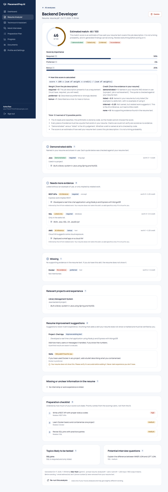 | 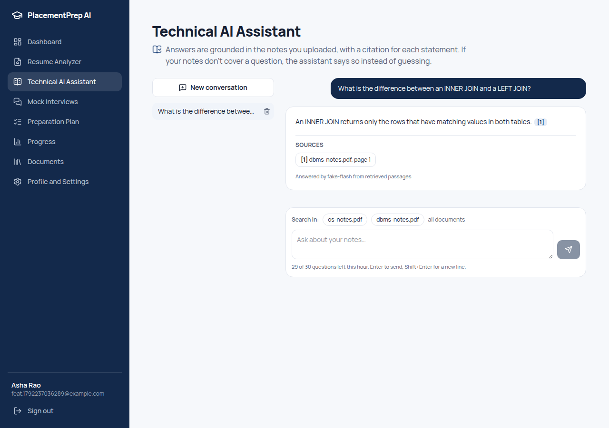 |
| 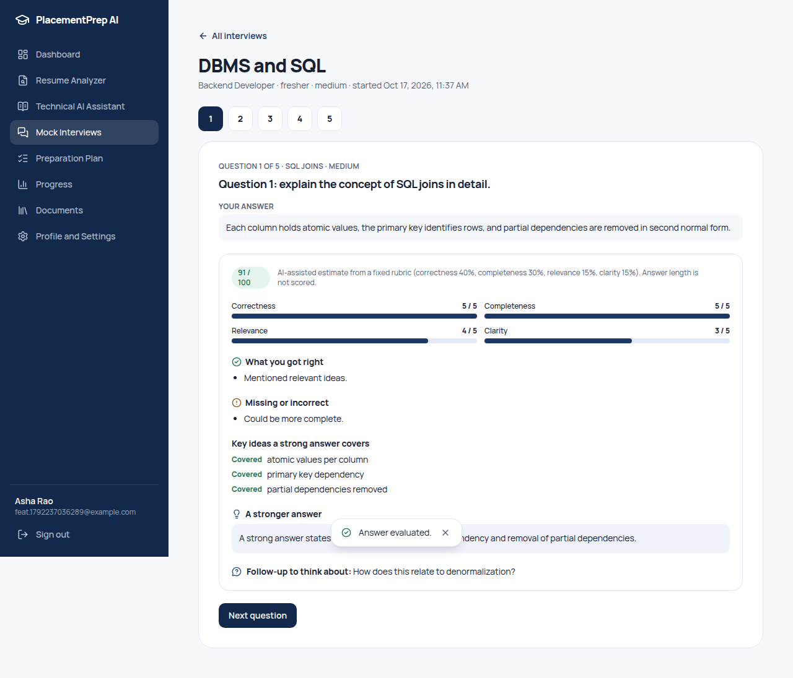 | 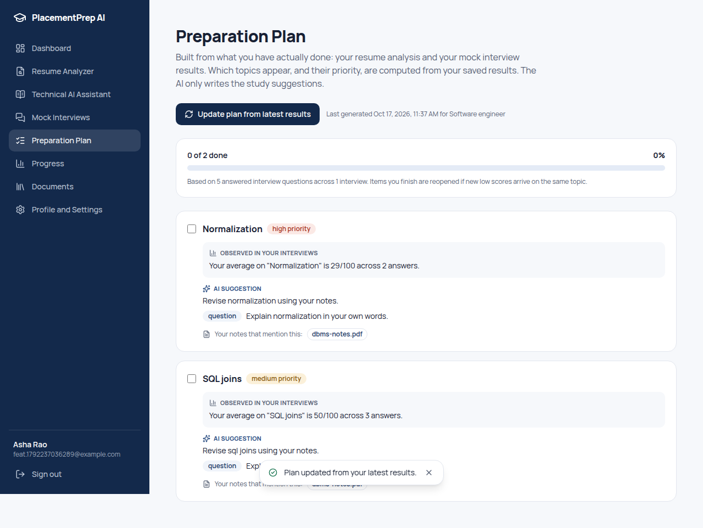 |
| 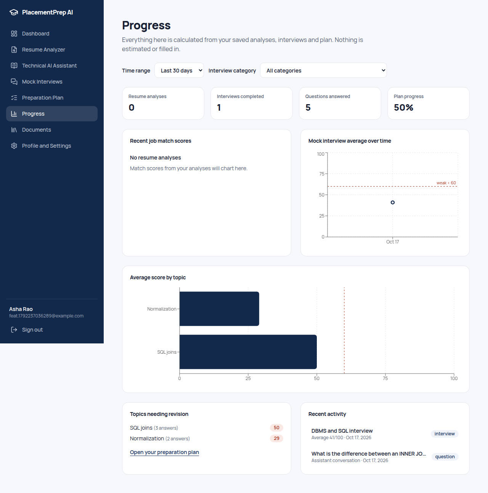 | 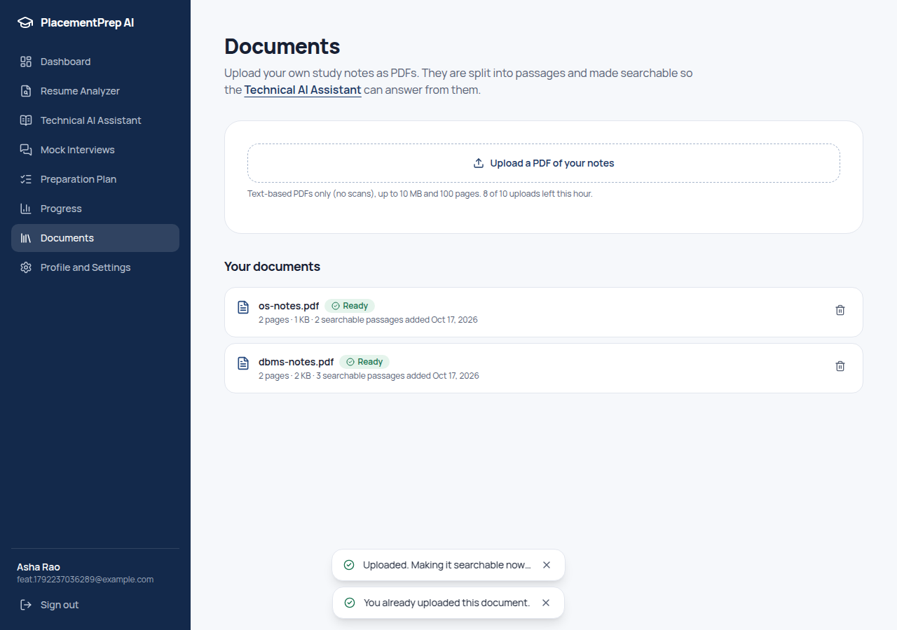 |
| 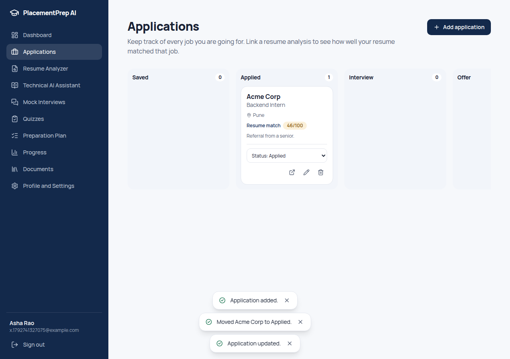 | 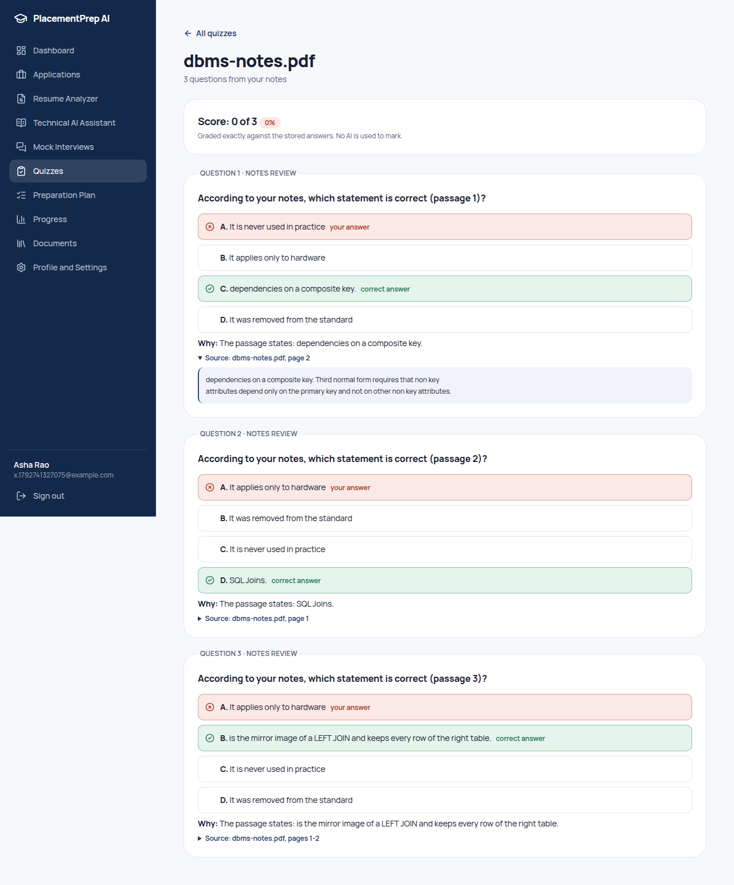 |
| 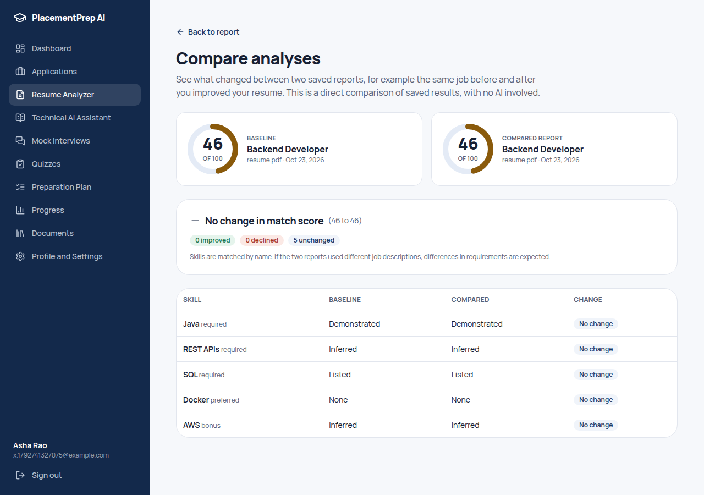 | |

## Architecture
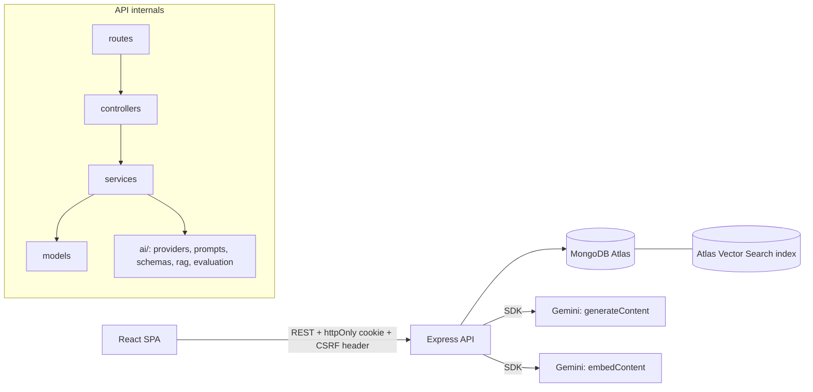
Layers: `routes` (HTTP + middleware order) → `controllers` (thin) → `services` (business logic) → `models`. The `ai/` folder holds provider adapters, versioned prompts, Zod schemas, structured-output validation, retry/quota, chunking, retrieval and evaluation. Everything external is **injected** (`createApp({ llm, embedder, retriever, ... })`), so tests use doubles and production uses the real providers.

## The RAG pipeline (explain this in interviews)
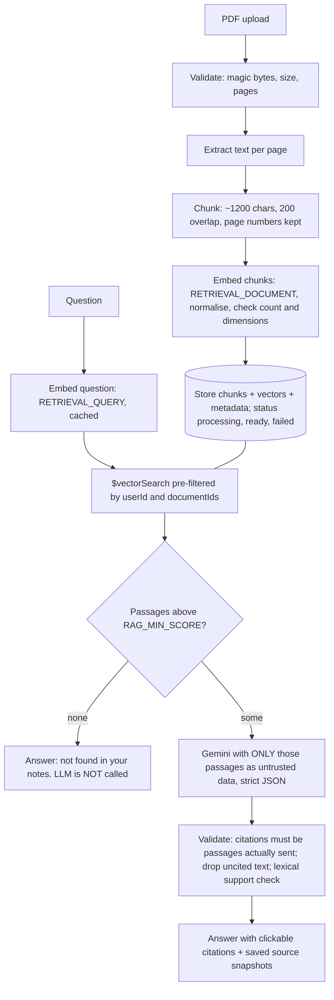
Key points: documents are embedded **once** at upload (not per question); identical passages reuse vectors; ingestion writes chunks only after **all** embeddings succeed; the retrieval step genuinely runs and decides what the model sees; the model cannot cite what it was not given; two abstention layers (relevance threshold, then the model's own `sufficient: false`).

## Scoring in one paragraph
The model **classifies**, code **decides**. Resume match: `score = 100 × Σ(weight × credit) / Σ(weight)` (required 3 / preferred 2 / bonus 1; demonstrated 1 / listed 0.5 / inferred 0.25 / none 0), every evidence quote verified against the resume text, unverified claims scored as none. Interview: completeness from rubric coverage, correctness capped when no key point is covered, `overall = 100 × (0.4·correctness + 0.3·completeness + 0.15·relevance + 0.15·clarity) / 5`, answer length never an input. Plans: which items exist and their priority come from saved results (a topic needs ≥2 answers and an average below 60 to be called a weakness; one low answer is only "limited evidence"). All scores are estimates, labelled as such in the UI.

## Run it locally
Prerequisites: Node 22, a MongoDB Atlas account (free M0 is enough), a Google AI Studio API key.
```bash
# Backend
cd server && npm install && cp .env.example .env     # set MONGODB_URI, JWT_SECRET, GEMINI_API_KEY, LLM_MODEL, EMBEDDING_MODEL
npm run ai:check:full                            # verifies key, models, structured output, embeddings (real API)
npm run vector:index                                  # creates the Atlas vector index (see docs/ATLAS_VECTOR_SEARCH.md)
npm run dev                                           # http://localhost:5000

# Frontend (new terminal)
cd client && npm install && npm run dev               # http://localhost:5173
```
Open **`http://localhost:5173`** (not `127.0.0.1`): the API rejects requests whose `Origin` differs from `CLIENT_URL`.
No Atlas yet? Set `VECTOR_SEARCH_MODE=local` for development (exact cosine in Node; not for production).
Generate a secret: `node -e "console.log(require('crypto').randomBytes(48).toString('base64url'))"`. API keys live only in `server/.env` (git-ignored).

### Useful scripts (`server/`)
| Command | Purpose |
|---|---|
| `npm run ai:check [-- --full]` | Verify your Gemini key, model IDs, structured output, embedding dimension, `taskType` |
| `npm run vector:index` | Create/inspect the Atlas vector index |
| `npm run rag:eval` | Run the RAG evaluation set through the real pipeline and print metrics |
| `npm test` / `npm run lint` | 265 tests / ESLint |

## Tests
```bash
cd server && npm test && npm run lint      # 265 tests; needs MongoDB: MONGODB_URI_TEST (default mongodb://127.0.0.1:27017/placementprep_test)
cd client && npm run lint && npm run build
cd e2e && npm install && CHROME_PATH=/path/to/chrome npm start && CHROME_PATH=/path/to/chrome node features.mjs && CHROME_PATH=/path/to/chrome node extras.mjs   # 49 + 47 + 32 browser checks
```
The test helper **refuses to run unless the database name ends in `_test`** (tests delete data). Mocked vs real: unit/integration tests use doubles for the model and embeddings; provider tests run the real SDK against a local wire-format fake; **no automated test calls live Gemini**.

### RAG evaluation
`server/eval/` holds a small corpus, 10 questions whose answer is in the notes, and 4 whose answer is not. `npm run rag:eval` reports retrieval hit@k and MRR, citation validity, a lexical support share, and whether negatives were correctly refused. Limits: tiny dataset; "hit" means a retrieved passage contains the expected snippet, not that the answer is right; support is a word-overlap heuristic. Tests prove the metrics are *sensitive* (a broken retriever or a gullible model scores worse), not that your pipeline scores well.

## Deployment, security, docs
- [docs/DEPLOYMENT.md](docs/DEPLOYMENT.md): Render + Vercel + Atlas, cookie/hosting options and trade-offs
- [docs/ATLAS_VECTOR_SEARCH.md](docs/ATLAS_VECTOR_SEARCH.md): index definition and pitfalls
- [docs/SECURITY.md](docs/SECURITY.md): threat controls, what is sent to Google, deletion behaviour
- [docs/AI_PROVIDER_NOTES.md](docs/AI_PROVIDER_NOTES.md): what was verified about Gemini, how, and what wasn't

## Known limitations
- Live Gemini and Atlas behaviour unverified (see top). Model IDs, pricing and free-tier limits change; check them.
- AI calls run inside the HTTP request (up to about a minute). A job queue with polling would be sturdier. Document embedding runs in a background task in the same process and is lost on restart (such documents are marked failed on boot).
- Quotas, rate limits, in-flight de-duplication and the query-vector cache are in memory: correct for one server instance only. Use a shared store (e.g. Redis) to scale out.
- Text-based PDFs only (no OCR); quote matching depends on PDF text-extraction quality for multi-column layouts.
- The assistant treats each question independently (no follow-up resolution such as "what about its performance?"). Conversation history is for review.
- A hostile document can influence the wording of an answer about itself; mitigations reduce but do not eliminate prompt injection.
- No email verification, password reset or MFA (password change and account deletion do exist). Registration reveals whether an email is taken (usability trade-off).
- Accessibility was designed in (labels, focus, keyboard, native dialogs, text alternatives for charts) but not audited with assistive technology.

## Future improvements
Job queue + status polling for AI work (deliberately not built: it needs a real queue such as Redis to be worth the complexity); Redis-backed limits; OCR for scanned PDFs; query rewriting using conversation history; hybrid (keyword + vector) retrieval and re-ranking; streaming answers; spaced-repetition scheduling in the plan; voice interviews; email verification and password reset; automated dependency updates; accessibility audit; larger evaluation set.

## Interview questions this project prepares you for
**Architecture and security**
1. Walk through authentication. Why an httpOnly cookie, and how do you stop CSRF when the cookie is sent automatically? (JWT-carried CSRF value + header, Origin check, CORS)
2. How do you guarantee one user can never read another's data? Where is that tested? (userId in every query, 404 not 403, vector pre-filter, cross-user tests)
3. How are uploads validated, and why not trust the extension or MIME type? Why never write them to disk?
4. How do you protect an expensive AI endpoint? (consent gate, per-user quotas with refund, caching, de-duplication, token cap, bounded retries)

**AI engineering**
5. Why doesn't the model output the score? How does a prompt-injected resume try to game it, and what stops it? (strict schema, code-side scoring, quote verification)
6. How do you detect hallucinated evidence or citations? What are the false-positive/negative risks?
7. Why validate with Zod when you already send a JSON schema? Why prune that schema before sending? (provider supports a subset; output is untrusted input)
8. Explain your retry policy: what is retried, why a long 429 isn't waited out, why the SDK's own retry is pinned. What does "repair once" do?
9. Explain RAG end to end. Why chunk with overlap? Why embed at upload, not per question? What is `RETRIEVAL_QUERY` vs `RETRIEVAL_DOCUMENT`?
10. Why must the vector index dimension match the stored vectors? What happens if you change embedding models? (re-embed everything, new index)
11. Why wrap query-vector numbers in BSON `Double`? (Int32 trap, demonstrated by experiment)
12. How do you evaluate RAG without overclaiming? What can your evaluation not tell you?
13. Where can RAG still fail even with all your safeguards? (retrieval misses, paraphrase vs support heuristic, prompt injection, chunk boundaries)

**Product and data**
14a. Why must account deletion iterate a registry of models, and how does a test stop you forgetting one? (`USER_OWNED_MODELS` + a guard test over every model with a `userId`)
14b. Why does the quiz server shuffle the options and grade in code? (the model cannot bias answer position; marking is exact and free)
14c. Why is a job link restricted to http(s)? (a `javascript:` URL in a link is an XSS vector)
14. How is interview scoring made fair and consistent, and why can't a long answer score higher? Why are answers final?
15. How does the plan avoid calling someone "weak" without evidence? (≥2 answers, average <60, "limited evidence" tier, observed vs AI-suggested labelling)
16. Why does deleting a resume or document cascade to derived data? What is deliberately kept?
17. How did you test AI code without calling the AI? What can those tests not prove? (wire-format fake with the real SDK; mock providers; the live gap)

**Scaling and operations**
18. What breaks when you run two server instances, and how would you fix each? (in-memory quotas/limits/dedup/cache, background jobs)
19. How would you make analysis and embedding asynchronous? How do you handle server restarts mid-job?
20. How would you deploy this, and what are the cookie/hosting trade-offs between same-site, cross-site and proxying? (see DEPLOYMENT.md)
